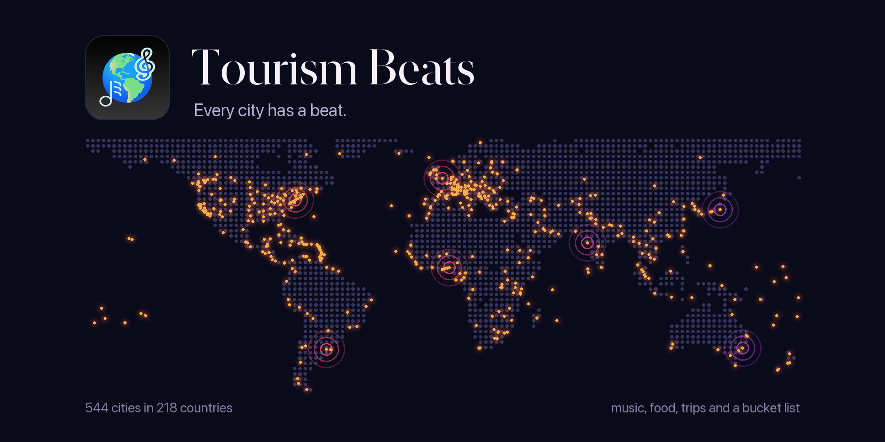

# Tourism Beats 🌍🎶

<kbd>
    
</kbd>

## Project Description 🎨

Tourism Beats is a native iOS application that offers an immersive experience exploring 544 cities in 218 countries. Users can browse a 3D interactive globe, discover cities on a full-screen map, dive into vertically pageable city profiles featuring real-time weather, local time, trending music, top activities, food journals, walkability scores, visa requirements, and safety advisories. The app integrates with Apple Music via MusicKit to surface trending songs by city and uses OpenStreetMap's Overpass API combined with Wikipedia and Wikidata enrichment for curated activity discovery with images. A personal food journal lets travelers track restaurants, dishes, and meal photos with SwiftData persistence. Trip planning with itinerary management, a flight countdown with a Home Screen widget, and a bucket list of the places to visit and things to do someday round out the experience.

## Technologies Used 💻

Built with native Apple frameworks, Apple platform services, and lightweight web APIs — zero third-party SDK dependencies.

### Frameworks

- [x] **SwiftUI** — Declarative UI with `@Observable`, `NavigationStack`, `Tab` API, and `MeshGradient`
- [x] **Observation** — State management powered by `@Observable` view models
- [x] **SwiftData** — Persistent storage for restaurants, meal photos, trip itineraries, and the bucket list
- [x] **WidgetKit** — Standalone flight countdowns shared through an App Group
- [x] **EventKitUI** — Permission-free New Event sheet for adding flights to any calendar account
- [x] **MapKit** — Interactive world map with city annotations and search
- [x] **CoreLocation** — Coordinate-based city discovery, filtering, and proximity logic
- [x] **WeatherKit** — Real-time weather conditions and forecasts per city
- [x] **MusicKit** — Apple Music integration for city charts, playlists, and album artwork
- [x] **SceneKit** — 3D interactive Earth globe on the home screen
- [x] **AVFoundation** — Playback coordination and audio-session-aware music experiences
- [x] **PhotosUI** — Out-of-process photo picker for meal photos and flight card photos
- [x] **UIKit** — Focused interop for quick actions, mail composition, and SceneKit hosting
- [x] **OSLog** — Structured logging across all services
- [x] **Swift Concurrency** — `async`/`await`, `actor` isolation, and structured tasks throughout

### APIs & Web Services

- [x] **Apple Music API** — Catalog charts, playlists, and track metadata surfaced through MusicKit-backed requests
- [x] **Spotify Accounts + Web API** — Optional authenticated mirroring of the selected song for Spotify deep links
- [x] **MapKit Local Search / Apple Maps data** — City search, attraction demand signals, and restaurant candidate discovery
- [x] **Overpass API (OpenStreetMap)** — Tourism POI and restaurant metadata enrichment
- [x] **Wikipedia REST API** — Lead summaries and imagery for activity and city enrichment
- [x] **MediaWiki Action API** — Wikipedia geosearch/page lookup and Wikivoyage guide parsing
- [x] **Wikivoyage API** — Travel-guide listings used to improve activity coverage and editorial relevance
- [x] **Wikidata API + Query Service** — Entity matching, award metadata, and Commons image resolution
- [x] **Wikimedia Commons** — Activity and destination image delivery

### Data Sources

- [x] **Static visa requirements JSON** — Offline visa lookup for all 39,601 passport-destination pairs (Passport Index data, February 2026)
- [x] **Static safety advisories JSON** — Offline country safety data with advisory levels

## Architecture 🏗️

- **Pattern**: MVVM with Clean Architecture and SOLID principles
- **State Management**: `@Observable` with `@MainActor` isolation (no `ObservableObject`)
- **Navigation**: `NavigationStack` with `NavigationPath` for programmatic routing and pop-to-root
- **Concurrency**: Swift 6.2 strict concurrency — `actor`-based services, structured `Task` hierarchies
- **Caching**: Two-tier caching (in-memory + disk) with 14-day TTL for activity data
- **Target**: iOS 26.0+, Swift 6.2, Xcode 26

## Features 🌟

- 🌐 **544 Cities** — Explore destinations in 218 countries across every continent, and find any of them by name, country, or state and province
- 🗺️ **Interactive Map** — Full world map with city pins and search
- 🌍 **3D Globe** — Animated Earth with featured city carousel on home screen
- 🎵 **Trending Music** — City-specific Apple Music playlists via MusicKit
- 🏛️ **Top Activities** — Curated POIs from OpenStreetMap enriched with Wikipedia content, each a tap away in Google Maps
- 🍽️ **Food Journal** — Track restaurants, best dishes, and meal photos per city; a new journal opens on the world's fifteen gastronomic capitals, ranked on Michelin stars, The World's 50 Best Restaurants and culinary heritage, with the five best cuisines from the TasteAtlas Awards a filter away
- ✈️ **Trip Planner** — Create and manage trip itineraries with activities, and fill any trip or day with suggested sights and restaurants from the city guide, grouped by area, centred on your hotel when you add one, and reviewed before they are added
- ✈️ **Flight Countdown** — Settings → Tools; count down to any flight, yours or a loved one's, by searching airlines and airports by name or city, counted in months and days, then days and hours, then hours and minutes as departure nears, with five card designs or up to four of your own photos that take turns filling the card in a shuffled order, each framed by dragging and pinching it on the card, shown in a small or medium Home Screen widget that counts down to your next flight and moves on to the one after once it departs, and added to Apple, Google, Outlook, or Notion Calendar without calendar access
- ✅ **Bucket List** — Settings → Tools; save the places you dream of and the things you want to do in one form, find a place with a single search across countries and the app's cities, add or remove a city straight from its page, and check items off as you go, with fireworks waiting on an empty list
- 🌤️ **Live Weather** — Real-time conditions via WeatherKit
- 🕐 **Local Time** — A live clock for every city, with sweeping hands and a face that's light by day and dark by night there
- 🚶 **Walkability** — City walkability scores and pedestrian insights
- 🛂 **Visa Requirements** — Passport-specific visa lookup for any destination
- 🛡️ **Safety Advisories** — Country risk levels and travel warnings
- ♿ **Accessibility** — WCAG AA compliant contrast ratios, Dynamic Type, VoiceOver support
- 🎨 **Dark Mesh Gradients** — 34 unique dark-palette `MeshGradient` backgrounds

## Contributing ⚙️

We welcome contributions from developers and enthusiasts who are passionate about creating immersive mobile experiences. If you have an idea for a new feature or a code improvement, feel free to fork our repository, make your changes, and submit a pull request. Let's collaborate to enhance Tourism Beats together.

## License 🪪

This project is licensed under the MIT License, allowing you to modify, distribute, and use the code with proper attribution to the original creators. Let's keep the spirit of open-source collaboration alive!

## Data Sources

Airport and airline directories are bundled for offline search; see [THIRD_PARTY_NOTICES.md](THIRD_PARTY_NOTICES.md) for sources and licenses.
